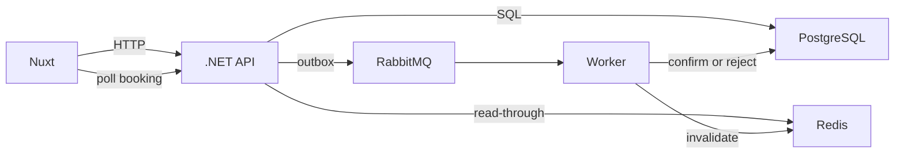

# HotelPulse

[](https://github.com/evgenest/HotelPulse/actions/workflows/ci.yml)

HotelPulse is a small hotel booking service. A guest picks a room, the API accepts the request immediately, and a worker confirms the stay from a durable queue. The room cannot be sold twice for the same dates.

It is a learning project. The aim is not only working code and a demo, but to understand how a production system is put together end to end, from the database to the browser: which decisions affect reliability, performance and the business rules, and why. Those decisions and the problems behind them are written down in [`docs/adr/`](docs/adr/README.md) (in Russian), with a glossary. Start with [`docs/why-not-mvp.md`](docs/why-not-mvp.md): every decision on one page, with what would break without it.

## Live demo

- Web: https://hotelpulse-web.onrender.com
- API: https://hotelpulse-api.onrender.com ([`/health`](https://hotelpulse-api.onrender.com/health), [`/api/hotels`](https://hotelpulse-api.onrender.com/api/hotels))

Both run on Render's free plan in Frankfurt, with Postgres on Neon and RabbitMQ on CloudAMQP. Free services sleep when idle, so the first request can take up to a minute.

## Architecture



`POST /api/bookings` validates the stay, writes the booking and an outbox row in one transaction, and returns **202 Accepted** with `status: pending`. A relay in the API publishes `booking.created` to the durable queue `bookings.created`. The worker advances the event timeline and sets `confirmed` or `rejected`. The page polls `GET /api/bookings/{id}` until that happens.

If the worker is down, the message stays in RabbitMQ and the booking stays `pending`. Starting the worker consumes it. A second delivery of a booking that is already finished is acknowledged and ignored. If Postgres rejects the insert because another active stay overlaps, the API returns **409**.

Hotel list, hotel detail, and availability are cached in Redis. A booking write increments a version key, so the next read misses and loads PostgreSQL. Entries also expire after 60 seconds. Responses carry `X-Cache: HIT`, `MISS`, or `BYPASS`.

## Two implementations of one API

The same HTTP contract ([`docs/api.md`](docs/api.md)) is implemented twice:

| | .NET | Laravel |
|---|---|---|
| Code | `apps/api`, `apps/worker`, `apps/HotelPulse.*` | `apps/api-laravel` |
| Runtime | ASP.NET Core, .NET 10 | PHP 8.5, Laravel 13, Octane on FrankenPHP |
| Tests | xUnit + Testcontainers | Pest, against real Postgres, Redis and RabbitMQ |

The Laravel version was written to learn Laravel on a project whose rules were already pinned down, spec first ([`docs/specs/laravel-port.md`](docs/specs/laravel-port.md)) and with Claude Code. Both versions keep the same concurrency rules in SQL ([`docs/adr/`](docs/adr/README.md)), run the same scenarios as tests, including the parallel ones, and use the same schema files. Each has its own database, queue and cache keys, so they can run side by side. The web app has a **.NET / Laravel** switch in the header when both are configured.

## Stack

| Piece | Where |
|---|---|
| C# / .NET 10 | `apps/api`, `apps/worker`, shared domain and infrastructure projects |
| PHP 8.5 / Laravel 13 | `apps/api-laravel`: the same API, outbox relay and worker |
| PostgreSQL 18 | Hotels, rooms, bookings. SQL migrations, exclusion constraint, partial indexes |
| Redis 8 | Cache for catalog and availability reads |
| RabbitMQ 4 | Durable `bookings.created` queue, manual ack, transactional outbox |
| Nuxt 4 / Vue 3 / TypeScript | `apps/web` |
| xUnit | Unit tests and integration tests. Testcontainers locally, service containers in CI |
| Docker Compose | Local stack and `docker-compose.prod.yml` |
| Caddy | HTTPS on a single VPS |
| Kubernetes | Manifests in `k8s/` |

The overlap rule and the measured `EXPLAIN` plans are in [`docs/sql.md`](docs/sql.md). The HTTP contract is in [`docs/api.md`](docs/api.md).

## Run

Docker Compose:

```bash
docker compose up -d --build

curl -fsS http://localhost:8080/health
curl -fsS http://localhost:8080/api/hotels
```

The Laravel API is in the `laravel` profile. Put a key in `.env` first:

```bash
echo "LARAVEL_APP_KEY=base64:$(openssl rand -base64 32)" >> .env
echo "NUXT_PUBLIC_API_BASE_LARAVEL=http://localhost:8081" >> .env
docker compose --profile laravel up -d --build
curl -fsS http://localhost:8081/health
```

The app is at <http://localhost:3000>. RabbitMQ management is at <http://localhost:15672> (`hotelpulse` / `hotelpulse`).

Migrations run when the API starts and insert the six hotels. An older checkout of this repo used MongoDB; `docker compose down -v` drops that unused volume along with the Postgres data.

Without Compose, run Postgres, Redis, and RabbitMQ yourself (guest user is fine on localhost), then:

```bash
dotnet run --project apps/api
dotnet run --project apps/worker
cd apps/web && pnpm install && pnpm dev
```

Kubernetes: build the images, load them into `kind` or `minikube`, then apply the namespace before the other manifests.

```bash
docker build -t hotelpulse-api:dev    -f apps/api/Dockerfile .
docker build -t hotelpulse-worker:dev -f apps/worker/Dockerfile .
docker build -t hotelpulse-web:dev    -f apps/web/Dockerfile apps/web

kubectl apply -f k8s/namespace.yaml && kubectl apply -f k8s/
kubectl port-forward svc/api 8080:8080 -n hotelpulse
kubectl port-forward svc/web 3000:3000 -n hotelpulse
```

Postgres keeps a persistent volume. Redis is a cache and does not. How that volume behaves on `kind` and `minikube` is described in [`docs/kubernetes-storage-en.md`](docs/kubernetes-storage-en.md). A single VPS does not need the manifests; see [`DEPLOY.md`](DEPLOY.md).

## Test

```bash
npm run test:unit           # booking rules, no Docker
npm run test:integration    # API, worker, Postgres, Redis, RabbitMQ
npm test                    # both
npm run typecheck           # Nuxt / Vue
```

Laravel (PHP 8.5 with `pdo_pgsql`, `redis`, `pcntl`, `sockets`, `bcmath`; set `DATABASE_URL`, `REDIS_URL`, `AMQP_URL`):

```bash
cd apps/api-laravel && composer install
./vendor/bin/pest          # unit + feature, including parallel requests
./vendor/bin/pint --test   # code style
./vendor/bin/phpstan analyse   # Larastan, level 8
```

Load test (k6 in Docker, both APIs, thresholds from the spec): see [`docs/benchmarks.md`](docs/benchmarks.md).

Integration tests use Testcontainers when Docker is available and `POSTGRES_URI` is unset. Set `POSTGRES_URI`, `REDIS_URI`, and `RABBITMQ_URI` to point them at services you already started. CI does that with service containers, then builds the three images. See [`.github/workflows/ci.yml`](.github/workflows/ci.yml).

`HOTELPULSE_CONFIRM_PROBABILITY` defaults to `0.9`, so a live booking is occasionally rejected with "Room became unavailable during processing." Set it to `1` when you want every stay to confirm. `HOTELPULSE_STEP_DELAY_MS` replaces the 700 / 800 / 900 ms pipeline delays; tests set it to `0`.

## Failure demo

```bash
docker compose stop worker

curl -s -X POST http://localhost:8080/api/bookings \
  -H 'Content-Type: application/json' \
  -d '{"hotelId":"h_porter","roomId":"r2","guestName":"Anna Schmidt","checkIn":"2027-04-01","checkOut":"2027-04-03","nights":2,"total":390}'

# status stays pending — the message is sitting in the durable queue
docker compose start worker
# the same booking moves to confirmed
```

The same sequence works from the site: stop the worker, book a room, watch the page stay on "Processing", start the worker, and the poll flips to confirmed.

## Deploy

[`DEPLOY.md`](DEPLOY.md) covers two ways to run it.

A VPS uses `docker-compose.prod.yml`: copy `.env.example` to `.env`, point DNS at the machine, and run `docker compose -f docker-compose.prod.yml up -d --build`. Caddy requests the certificate. The worker is its own container.

A free Render demo uses [`render.yaml`](render.yaml). The API and the Nuxt server are free web services, Redis is Render Key Value, Postgres is a Neon database, and RabbitMQ is CloudAMQP. Render's free plan has no background workers, so that Blueprint sets `RUN_WORKER_IN_PROCESS=true` and the API process consumes the queue itself. That flag stays off for Compose, Kubernetes, and `apps/worker`. The API reads `DATABASE_URL`, `REDIS_URL`, `AMQP_URL`, and `PORT` when those are set, and still accepts `POSTGRES_URI`, `REDIS_URI`, and `RABBITMQ_URI` for the local stack. Nothing in this repository is deployed on its own.

## Repository

```
apps/api/                         HTTP API
apps/worker/                      queue consumer
apps/web/                         Nuxt app
apps/api-laravel/                 Laravel implementation of the API, relay and worker
docs/adr/                         architecture decision records and a glossary (Russian)
apps/HotelPulse.Domain/           validation, status transitions, timeline, delivery policy
apps/HotelPulse.Infrastructure/   SQL migrations, repositories, Redis, outbox, consumer
tests/                            unit and integration tests
k8s/                              namespace, Postgres, Redis, RabbitMQ, API, worker, web, ingress
deploy/Caddyfile                  production proxy
docker-compose.yml                local stack
docker-compose.prod.yml           single-host production stack
render.yaml                       Render free-tier blueprint (Neon + CloudAMQP)
```

Accounts and card payments are outside this service. Booking history in the browser is a local cache of the API list; the rows themselves are in Postgres.
