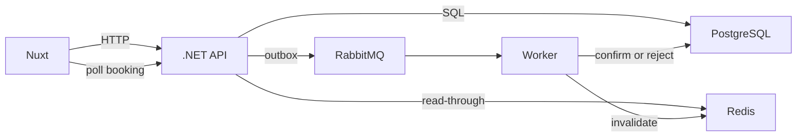

# HotelPulse

[](https://github.com/evgenest/HotelPulse/actions/workflows/ci.yml)

HotelPulse — небольшой сервис бронирования отелей. Гость выбирает номер, API сразу принимает запрос, а воркер подтверждает заезд из устойчивой очереди. Один и тот же номер нельзя продать дважды на одни даты.

Живое демо: _добавьте публичный URL после деплоя на VPS._

## Архитектура



`POST /api/bookings` проверяет заезд, в одной транзакции пишет бронь и строку outbox и возвращает **202 Accepted** со `status: pending`. Релей в API публикует `booking.created` в устойчивую очередь `bookings.created`. Воркер двигает ленту событий и ставит `confirmed` или `rejected`. Страница опрашивает `GET /api/bookings/{id}`, пока статус не станет окончательным.

Если воркер остановлен, сообщение остаётся в RabbitMQ, а бронь остаётся `pending`. Запуск воркера её забирает. Повторная доставка уже завершённой брони подтверждается и игнорируется. Если Postgres отклоняет вставку из-за пересечения с другим активным заездом, API отвечает **409**.

Список отелей, карточка отеля и доступность кэшируются в Redis. Запись брони увеличивает версию ключа, поэтому следующее чтение идёт в PostgreSQL. Записи также живут 60 секунд. Ответы несут `X-Cache: HIT`, `MISS` или `BYPASS`.

## Стек

| Часть | Где |
|---|---|
| C# / .NET 10 | `apps/api`, `apps/worker`, общие проекты домена и инфраструктуры |
| PostgreSQL 18 | Отели, номера, брони. SQL-миграции, exclusion-constraint, частичные индексы |
| Redis 8 | Кэш каталога и чтений доступности |
| RabbitMQ 4 | Устойчивая очередь `bookings.created`, ручной ack, transactional outbox |
| Nuxt 4 / Vue 3 / TypeScript | `apps/web` |
| xUnit | Юнит- и интеграционные тесты. Testcontainers локально, service containers в CI |
| Docker Compose | Локальный стек и `docker-compose.prod.yml` |
| Caddy | HTTPS на одном VPS |
| Kubernetes | Манифесты в `k8s/` |

Правило пересечения дат и снятые планы `EXPLAIN` — в [`docs/sql.md`](docs/sql.md). HTTP-контракт — в [`docs/api.ru.md`](docs/api.ru.md).

## Запуск

Docker Compose:

```bash
docker compose up -d --build

curl -fsS http://localhost:8080/health
curl -fsS http://localhost:8080/api/hotels
```

Приложение: <http://localhost:3000>. Управление RabbitMQ: <http://localhost:15672> (`hotelpulse` / `hotelpulse`).

Миграции выполняются при старте API и вставляют шесть отелей. Более ранний checkout этого репозитория использовал MongoDB; `docker compose down -v` удаляет тот неиспользуемый volume вместе с данными Postgres.

Без Compose поднимите Postgres, Redis и RabbitMQ сами (`guest` на localhost подходит), затем:

```bash
dotnet run --project apps/api
dotnet run --project apps/worker
cd apps/web && pnpm install && pnpm dev
```

Kubernetes: соберите образы, загрузите их в `kind` или `minikube` и примените namespace раньше остальных манифестов.

```bash
docker build -t hotelpulse-api:dev    -f apps/api/Dockerfile .
docker build -t hotelpulse-worker:dev -f apps/worker/Dockerfile .
docker build -t hotelpulse-web:dev    -f apps/web/Dockerfile apps/web

kubectl apply -f k8s/namespace.yaml && kubectl apply -f k8s/
kubectl port-forward svc/api 8080:8080 -n hotelpulse
kubectl port-forward svc/web 3000:3000 -n hotelpulse
```

У Postgres есть постоянный volume. У Redis его нет: это кэш. Как volume ведёт себя на `kind` и `minikube`, описано в [`docs/kubernetes-storage-ru.md`](docs/kubernetes-storage-ru.md). Для одного VPS манифесты не нужны; см. [`DEPLOY.md`](DEPLOY.md).

## Тесты

```bash
npm run test:unit           # правила бронирования, без Docker
npm run test:integration    # API, воркер, Postgres, Redis, RabbitMQ
npm test                    # оба проекта
npm run typecheck           # Nuxt / Vue
```

Интеграционные тесты используют Testcontainers, если Docker доступен и `POSTGRES_URI` не задан. Задайте `POSTGRES_URI`, `REDIS_URI` и `RABBITMQ_URI`, чтобы направить их на уже запущенные сервисы. CI делает это через service containers и затем собирает три образа. См. [`.github/workflows/ci.yml`](.github/workflows/ci.yml).

`HOTELPULSE_CONFIRM_PROBABILITY` по умолчанию `0.9`, поэтому живая бронь иногда отклоняется с причиной «Room became unavailable during processing.». Поставьте `1`, если каждый заезд должен подтверждаться. `HOTELPULSE_STEP_DELAY_MS` заменяет задержки 700 / 800 / 900 мс; тесты ставят `0`.

## Сбой воркера

```bash
docker compose stop worker

curl -s -X POST http://localhost:8080/api/bookings \
  -H 'Content-Type: application/json' \
  -d '{"hotelId":"h_porter","roomId":"r2","guestName":"Anna Schmidt","checkIn":"2027-04-01","checkOut":"2027-04-03","nights":2,"total":390}'

# статус остаётся pending — сообщение лежит в устойчивой очереди
docker compose start worker
# та же бронь переходит в confirmed
```

То же самое с сайта: остановите воркер, забронируйте номер, страница останется на «Processing», запустите воркер — опрос переключится на confirmed.

## Деплой

[`DEPLOY.md`](DEPLOY.md) описывает два пути. VPS — `docker-compose.prod.yml`, воркер в своём контейнере. Бесплатное демо на Render — [`render.yaml`](render.yaml): API и Nuxt как web-сервисы, Redis как Key Value, Postgres на Neon, RabbitMQ на CloudAMQP. На бесплатном плане Render нет background worker, поэтому Blueprint ставит `RUN_WORKER_IN_PROCESS=true` и очередь читает сам процесс API. В Compose, Kubernetes и `apps/worker` этот флаг выключен. API понимает `DATABASE_URL`, `REDIS_URL`, `AMQP_URL` и `PORT`, а локальный стек по-прежнему задаёт `POSTGRES_URI`, `REDIS_URI` и `RABBITMQ_URI`. Репозиторий сам никуда не деплоится.

## Репозиторий

```
apps/api/                         HTTP API
apps/worker/                      потребитель очереди
apps/web/                         приложение Nuxt
apps/HotelPulse.Domain/           валидация, переходы статусов, лента, политика доставки
apps/HotelPulse.Infrastructure/   SQL-миграции, репозитории, Redis, outbox, consumer
tests/                            юнит- и интеграционные тесты
k8s/                              namespace, Postgres, Redis, RabbitMQ, API, worker, web, ingress
deploy/Caddyfile                  прокси для продакшена
docker-compose.yml                локальный стек
docker-compose.prod.yml           продакшен на одном хосте
```

Учётные записи и оплата картой в этот сервис не входят. История в браузере — локальный кэш списка API; сами строки лежат в Postgres.
